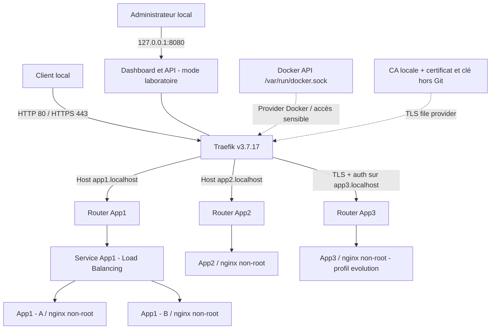

# Cartographie de sécurité - TP5 DevTech Solutions

## Architecture du laboratoire

**Précisions** : Traefik (client du socket Docker) découvre les conteneurs étiquetés ; seuls les ports hôtes Traefik 80, 443 et 8080 sont publiés sur 127.0.0.1. App1, App1b, App2 et App3 sont sur `frontend` ; le réseau commun facilite le laboratoire, mais ne constitue **pas** une segmentation des applications. Les certificats et hashes ne sont générés que sur la machine d'exécution.

## Matrice sécurité exigée par la section 20

P1 = à traiter avant une exposition hors du laboratoire. P2 = durcissement/administration.

| Composant / flux | Exposition et données | Risque principal | Protection requise | Preuve attendue | Responsable proposé | Priorité |
|---|---|---|---|---|---|---|
| Client -> Traefik (80/443) | Trafic HTTP / HTTPS, éventuels identifiants | Interception, accès non autorisé, saturation | TLS reconnu par client, redirection future, limiter l'exposition réseau, authentifier les routes privées | curl HTTPS avec CA locale et sans -k ; inspection des ports ; test de refus | DevOps / Réseau | P1 |
| Admin -> dashboard + API | Métadonnées, routes, backends | Divulgation de topologie | Dashboard sur loopback en labo ; en prod API insecure OFF, VPN/réseau privé + auth | `docker inspect` 127.0.0.1:8080 ; essais dashboard+API depuis poste non autorisé | DevOps | P1 |
| Traefik -> Docker API | Socket d'administration du daemon | Compromission potentielle du daemon/hôte | Remplacer le socket direct par socket-proxy filtrant ; aucun socket dans Nginx ; accès minimal | Inspection mounts et ACL ; tests du proxy filtrant dans cible durcie | Administration système | P1 |
| Traefik -> App1/App1B | HTTP backend Docker privé | Contournement proxy, panne backend | Aucun port Nginx sur l'hôte ; healthchecks | docker inspect sans ports, deux backends visibles, test d'arrêt d'une instance | DevOps / App1 | P1 |
| Traefik -> App2/App3 | Réseau Docker, route app3 privée | Exposition involontaire, mouvement latéral | Opt-in explicite, authentification App3, segmentation cible | Label opt-in, 401/200 App3, test non-expose, schéma réseaux cibles | DevOps / Apps | P1 |
| Fichiers statiques/dynamiques et labels | Configuration de routage | Routage détourné, fuite de secrets | Versionner sans secrets, revue, permissions ; pas d'identifiants dans labels | Diff Git, grep de secrets, inspection de Compose | DevOps | P1 |
| CA/certificats / htpasswd | Clés privées locales, hash BCrypt | Usurpation, fuite de clés, expiration | Clés 0600, exclues de Git, rotation, certificat vérifié | `stat`, `git status`, `openssl verify`, curl --cacert | DevOps / Sécurité | P1 |
| Images et conteneurs | Traefik/Nginx | CVE, privilèges excessifs | Images maintenues, scan Trivy à exécuter, non-root Nginx, read_only, cap_drop | `docker inspect`, rapport Trivy réel, UID 101 | DevOps | P1 |
| Logs/metrics | Journaux HTTP / système | Exposition de données, manque de visibilité, disque saturé | Rétention limitée, redaction, rotation et contrôle d'accès | Échantillon expurgé, politique de rotation documentée | Exploitation | P2 |
| Hôte et instance Traefik | Infrastructure partagée | Point unique de défaillance | Backups, restauration testée, instances multi-hôtes si objectif HA | Test de panne hôte et restauration (non disponible dans ce TP local) | Infrastructure | P2 |

## Limites et risques résiduels honnêtes

- L'API/dashboard en `api.insecure=true` est accessible sans mot de passe **depuis la machine locale**. Tout utilisateur local suffisamment capable peut donc la consulter. Interdit hors laboratoire.
- L'accès direct au socket Docker est une capacité extrêmement sensible, même en montage `:ro`. C'est le risque principal du laboratoire.
- La CA locale, bien que vérifiée avec `--cacert`, n'est pas approuvée automatiquement par les navigateurs ou machines externes. Pas de domaine public ni de Let's Encrypt dans le TP.
- `nginxinc/nginx-unprivileged:stable-alpine` exécute Nginx non-root, mais les tags `stable-alpine` et `traefik:v3.7.17` ne garantissent pas à eux seuls une absence de CVE ; vérifier et éventuellement pinner un digest en production.
- Les conteneurs communiquent tous sur `frontend` ; la segmentation doit être ajoutée pour isoler les applications de sensibilités différentes.
- Le trafic entre Traefik et Nginx est en HTTP sur le réseau Docker ; la terminaison TLS au proxy ne protège pas automatiquement le tronçon backend.
- Le load balancing ne garantit ni la disponibilité de l'hôte, ni celle de Traefik ; aucun cluster multi-hôtes n'est mis en place.

## Évolution recommandée avant mise en production

1. **Entrée publique** : redirection HTTP->HTTPS, certificats ACME d'un domaine effectivement détenu, tests de renouvellement, TLS 1.2+ et HSTS après validation.
2. **Dashboard/API** : `api.insecure=false` ; router `api@internal` sur réseau admin/VPN avec authentification et ACL ; aucun port 8080 publié directement.
3. **Docker provider** : placer un socket-proxy Docker correctement filtré et non publié entre Traefik et le daemon ; restreindre les permissions d'accès au daemon et au fichier Compose.
4. **Segmentation** : réseaux `traefik-app1`, `traefik-app2`, `traefik-app3` avec Traefik joignant les trois, backends isolés les uns des autres ; tester concrètement les refus de communication inter-applications.
5. **Résilience** : instances Traefik et application sur au moins deux hôtes, supervision et procédure de reprise, tests de bascule.
6. **Chaîne logicielle** : versions/digests tracés, analyse Trivy réellement exécutée, politiques de correctifs, CI avec tests ; secret manager plutôt que fichiers locaux si nécessaire.

**Statut** : architecture cible seulement ; aucune mesure de la liste de production ne doit être présentée comme exécutée par ce kit.
